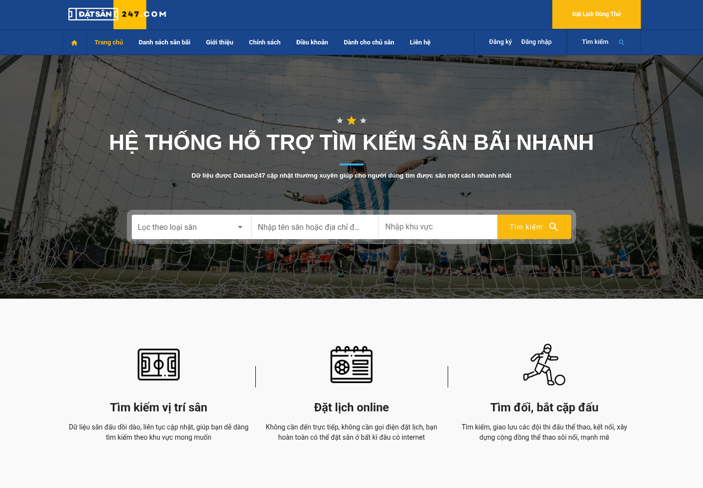
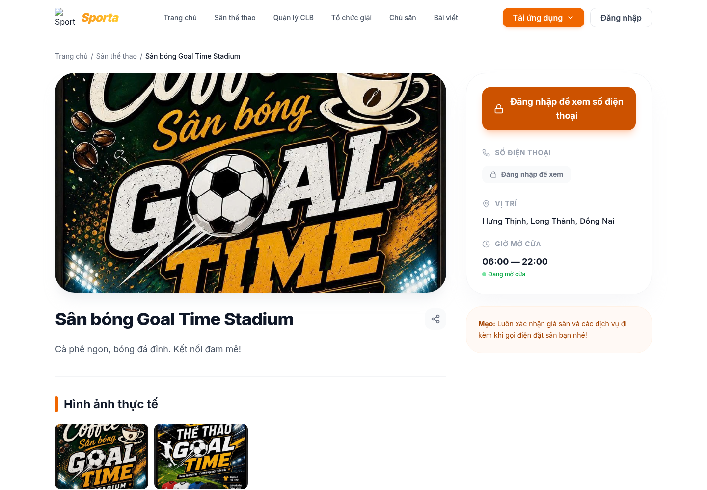
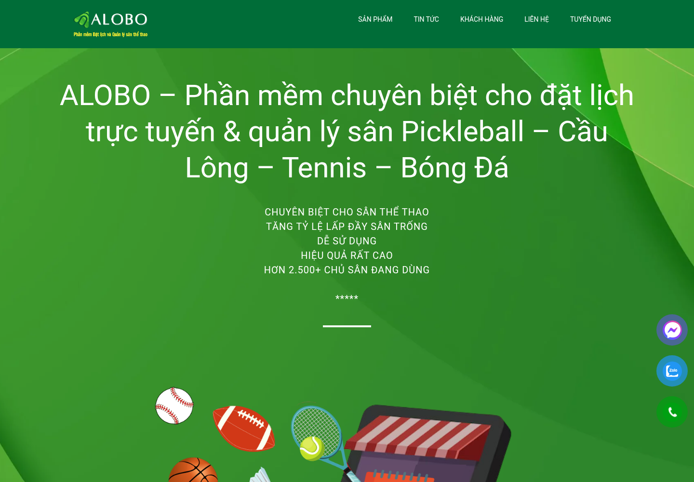
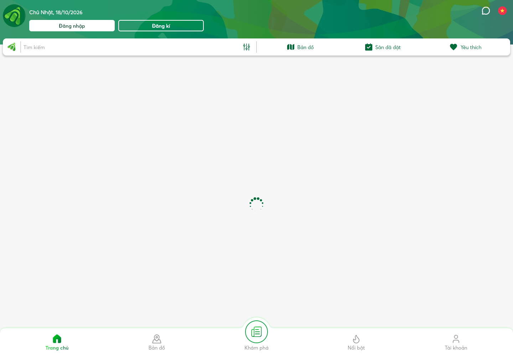
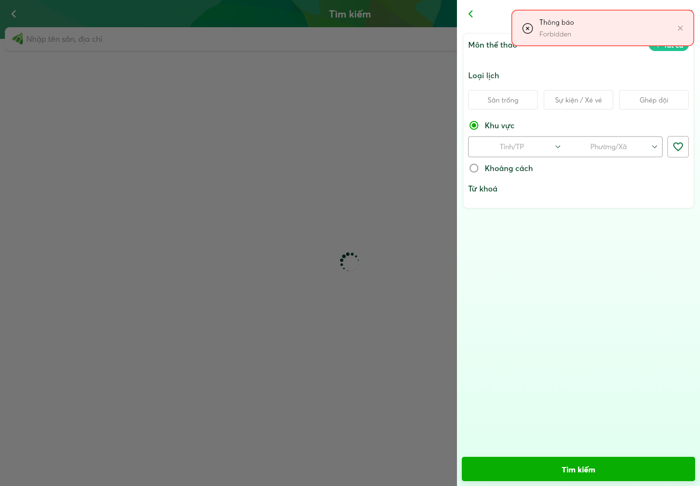

# Nhiệm vụ 2 — Phân tích ba website tham khảo cho ứng dụng đặt sân thể thao

**Học phần:** Phát triển ứng dụng WEB/TMĐT.  
**Nhóm đề tài:** Nhóm B — Ứng dụng đặt dịch vụ.  
**Đề tài:** Ứng dụng đặt sân thể thao.  
**Vai trò:** BA 2 / Market Researcher.  
**Ngày khảo sát:** 18/10/2026, múi giờ Asia/Bangkok.  
**Phạm vi:** khảo sát website công khai của ba dịch vụ tại Việt Nam; không đăng nhập, tạo lịch đặt thật hoặc thanh toán. Phân biệt quan sát giao diện với thông tin hướng dẫn do nhà cung cấp công bố.

## 1. Mục tiêu và cách chọn mẫu

Khảo sát nhằm tìm cách tổ chức thông tin, tìm sân và hỗ trợ đặt lịch phù hợp đồ án. Phân tích tập trung vào giá trị sử dụng và đánh đổi khi áp dụng, thay vì chỉ đếm tính năng hoặc xếp hạng website.

Theo mục 3, trang PDF 3–4 của `BaiTap_Nhom_Chuong1-1.pdf`, bảng giữ đúng năm cột và sáu tiêu chí trong mẫu. Với Nhóm B, “sản phẩm” được hiểu là sân/dịch vụ thuê sân; “giỏ hàng và đặt hàng” được chuyển thành chọn ngày, khung giờ và xác nhận đặt sân.

| Website | Đường dẫn | Căn cứ phù hợp thị trường Việt Nam | Lý do chọn |
|---|---|---|---|
| **A — Đặt Sân 247** | <https://datsan247.com/> | Website tiếng Việt; footer công bố Công ty Cổ phần Booking 247 và địa chỉ tại Hà Nội [A1]. | Tham khảo mô hình tìm sân nhiều môn và cách đưa bộ tìm kiếm lên trang chủ. |
| **B — Sporta** | <https://sporta.vn/> | Nội dung tiếng Việt, danh sách sân và khu vực tại Việt Nam; trang mẫu ở Long Thành, Đồng Nai [B1–B3]. | Tham khảo danh sách sân, tìm theo môn/khu vực và cách trình bày trang chi tiết. |
| **C — Alobo** | <https://www.alobo.vn/>; cổng đặt lịch: <https://datlich.alobo.vn/> | Website công bố Công ty TNHH Document Easy; có bài giới thiệu sân ở TP.HCM và liên kết cổng đặt lịch [C1–C3]. | Tham khảo cả phía người chơi và nghiệp vụ quản lý sân. Tách website giới thiệu với cổng đặt lịch để không nhầm hai loại giao diện. |

Thông tin doanh nghiệp trên được ghi nhận theo công bố của website, không phải kết quả xác minh đăng ký kinh doanh độc lập. Không dùng tuyên bố quảng cáo như “số 1” hoặc số lượng khách hàng để xếp hạng thị phần.

## 2. Bảng so sánh theo mẫu giảng viên

**Quy ước:** [A…], [B…], [C…] liên kết tới danh mục bằng chứng ở mục 5. “Chưa kiểm chứng” không đồng nghĩa tính năng không tồn tại. Các nhận xét cải thiện là đánh giá của người khảo sát trong phạm vi được nêu.

| Tiêu chí | Website A — Đặt Sân 247 | Website B — Sporta | Website C — Alobo | Đề xuất cho dự án |
|---|---|---|---|---|
| **Trang chủ** | Banner “Hệ thống hỗ trợ tìm kiếm sân bãi nhanh”; ngay trên banner có chọn loại sân, nhập tên/địa chỉ, khu vực và nút tìm kiếm. Bên dưới giới thiệu tìm vị trí sân, đặt lịch online, tìm đối và form dành cho chủ sân [A1]. **Đáng học:** người tìm sân nhận ra tác vụ chính ngay. | Có lối vào “Tìm & đặt sân”, các môn thể thao, sân gần tôi, sân nổi bật; đồng thời giới thiệu quản lý sân, CLB, giải đấu [B1]. **Đáng học:** thẻ sân và lối vào theo nhu cầu. Nhiều nhóm dịch vụ cần được ưu tiên lại cho phạm vi đồ án. | Trang chính thiên về giới thiệu phần mềm quản lý, tính năng và bài viết về sân [C1]. Cổng `datlich.alobo.vn` có màn hình giới thiệu ban đầu, nút “Bỏ Qua”, sau đó có tìm kiếm, bản đồ, sân đã đặt và yêu thích [C2]. **Đáng học:** các lối truy cập lại tác vụ quen thuộc. | Đưa tìm sân thành nội dung chính: môn, khu vực và nút tìm. Có sân gợi ý để mở chi tiết nhanh. Không bắt người dùng đi qua màn hình giới thiệu trước khi tìm sân; tách lối vào quản trị/chủ sân. |
| **Danh mục sản phẩm** *(loại sân/dịch vụ)* | Menu “Danh sách sân bãi” có bóng đá, tennis, golf, cầu lông, bóng bàn, pickleball [A1]. **Đáng học:** phân loại theo môn, đúng cách người chơi lựa chọn dịch vụ. Chưa kiểm chứng dữ liệu đầy đủ trong từng danh mục. | Trang danh sách có bộ chọn bóng đá, pickleball, cầu lông, cùng bộ chọn thành phố [B2]. **Đáng học:** kết hợp môn với địa điểm thay vì chỉ chia theo tên cơ sở. | Website giới thiệu các sản phẩm phần mềm cho pickleball, cầu lông, tennis, bóng đá [C1]. Đây là phân loại giải pháp cho chủ sân, **không phải bằng chứng** cổng đặt lịch có đủ danh sách/bộ lọc tương ứng. | Phân loại sân theo môn thể thao và khu vực. Phân biệt **cơ sở/cụm sân** với **sân con** có lịch riêng. Chỉ nhập các môn và khu vực nhóm có dữ liệu; không mở rộng danh mục chỉ để giống đối thủ. |
| **Tìm kiếm và lọc** | Giao diện trang chủ có loại sân, tên sân/địa chỉ và khu vực [A1]. **Đáng học:** tìm theo thông tin người chơi có sẵn. Chưa kiểm chứng độ chính xác kết quả và lọc theo lịch trống. | Quan sát được ô “Tìm tên sân...”, bộ chọn môn, thành phố và nút “Tìm sân trống” [B2]. Trang chủ cũng có lựa chọn dùng vị trí hiện tại [B1]. Chưa kiểm chứng mọi tổ hợp lọc hoặc kết quả sau cấp quyền vị trí. | Đã mở bộ lọc cổng đặt lịch: môn, loại lịch (sân trống, sự kiện/xé vé, ghép đội), khu vực tỉnh/TP–phường/xã hoặc khoảng cách, từ khóa [C2]. Có thông báo “Forbidden” và dữ liệu chưa tải xong trong lần thử; chưa kiểm chứng kết quả. | MVP ưu tiên tên sân, môn và khu vực; cho chọn ngày/giờ ở bước xem lịch. Chỉ trả nhãn “còn trống” sau kiểm tra dữ liệu lịch. GPS, tìm theo bán kính và bản đồ là mở rộng vì thêm quyền truy cập/phụ thuộc ngoài. |
| **Chi tiết sản phẩm** *(chi tiết sân)* | Đã xác nhận các liên kết danh mục trên trang chủ, nhưng chưa mở được một trang chi tiết sân ổn định trong phiên khảo sát [A2]. **Không gán** thông tin bảng giá, đánh giá hay lịch trống cho website khi chưa thấy. | Trang mẫu Goal Time Stadium hiển thị tên, mô tả, hình ảnh thực tế, vị trí Hưng Thịnh–Long Thành–Đồng Nai, giờ mở cửa 06:00–22:00 và mục đánh giá. Số điện thoại yêu cầu đăng nhập; trang nhắc xác nhận giá khi gọi đặt sân [B3]. | Bài về The B Hoàng Văn Thụ nêu địa chỉ, quy mô sân, mái che, ánh sáng, tiện ích, giờ hoạt động và link đặt lịch [C3]. Đây là **bài giới thiệu**, chưa phải xác nhận toàn bộ nội dung trang giao dịch; trang đặt sâu còn hiển thị đang tải trong phiên thử [C4]. | Trang sân cần ảnh, địa chỉ, môn/kiểu sân, tiện ích, giờ hoạt động, giá theo khung giờ và chính sách hủy. Hiển thị sân con và lịch ngày đã chọn. Tách “đang mở cửa” khỏi “còn lịch trống”: hai trạng thái này có ý nghĩa khác nhau. |
| **Giỏ hàng và đặt hàng** *(đặt sân)* | Trang chủ tự giới thiệu “Đặt lịch online”, có đăng ký/đăng nhập và liên kết chính sách thanh toán, hủy [A1]. Chưa kiểm chứng chuỗi chọn lịch → xác nhận/thanh toán; lời giới thiệu không được coi là bằng chứng đã thử thành công. | Nút “Đặt sân ngay” trên danh sách dẫn tới trang chi tiết. Ở sân mẫu, khách chưa đăng nhập được hướng dẫn đăng nhập để xem điện thoại và gọi xác nhận giá [B2–B3]. Chưa có bằng chứng luồng xác nhận lịch trực tuyến cho sân này ở trạng thái khách. | Hướng dẫn chính thức cho sân mẫu mô tả: tìm sân trong app → chọn ngày/giờ trống → đặt và thanh toán → gửi ảnh thanh toán → xác nhận [C3]. Đây là **quy trình được công bố**, chưa được thực hiện trọn luồng trong khảo sát. | Đặt trực tiếp một sân con/một khung giờ mỗi đơn, không bắt buộc giỏ hàng. Luồng: chọn lịch → xem tổng tiền/điều kiện → thông tin liên hệ → xác nhận → mã và trạng thái đặt. Server kiểm tra lại để ngăn trùng lịch; phân biệt gửi yêu cầu với đã được xác nhận. |
| **Điểm có thể cải thiện** | Trang chủ kết hợp nội dung người chơi với form đăng ký phần mềm cho chủ sân [A1]. **Nhận định:** đồ án nên tách hai hành trình để người chơi tập trung tìm lịch. Chưa đủ bằng chứng đánh giá chất lượng trang chi tiết hoặc tốc độ hệ thống. | Ở sân mẫu, người chơi chưa thấy giá cụ thể/lịch để tự quyết định và cần đăng nhập để lấy điện thoại [B3]. Popup quảng bá CLB cũng xuất hiện khi khảo sát [B4]. **Nhận định:** với đồ án đặt sân, nên ưu tiên thông tin và tác vụ đặt trước quảng bá khác. | Website giới thiệu, cổng đặt lịch và hướng dẫn app là các điểm chạm khác nhau [C1–C3]. **Nhận định:** đồ án nên giữ tìm sân, xem lịch và xác nhận trong một hành trình web. Không kết luận Alobo bắt buộc cài app vì thực tế có cổng web. | Cơ hội thiết kế: một hành trình rõ, giá/lịch minh bạch, điều kiện hủy dễ thấy và trạng thái đặt dễ hiểu. Đưa cộng đồng, quản lý CLB/giải, bán hàng tại sân và nhiều chi nhánh ra ngoài MVP để tập trung xử lý lịch chính xác. |

## 3. Phân tích điều đáng học và điều chưa phù hợp

### 3.1. Đặt Sân 247 — học cách bắt đầu từ nhu cầu tìm sân

**Đáng học:** ba trường loại sân, tên/địa chỉ và khu vực nằm trên banner; menu theo môn giúp người dùng bắt đầu mà không cần biết tên một cơ sở cụ thể. Cách tổ chức này phù hợp với nhu cầu “tôi cần một sân cho môn mình chơi ở khu vực thuận tiện”.

**Chưa phù hợp để đưa nguyên vào đồ án:** tìm đối/bắt cặp đấu và thu hút chủ sân sử dụng phần mềm là những hành trình bổ sung. Chúng yêu cầu thêm hồ sơ đội, nội dung cộng đồng hoặc nghiệp vụ kinh doanh phần mềm; không trực tiếp cần cho luồng đặt lịch cơ bản.

**Phương án đề xuất:** học bộ tìm kiếm trên trang chủ và phân loại theo môn. Tách giao diện quản trị khỏi hành trình người chơi. Chưa lấy website này làm chuẩn cho giao diện chi tiết, thanh toán hoặc lịch trống vì các phần đó chưa kiểm chứng trong phiên khảo sát.

### 3.2. Sporta — học cách khám phá sân và trình bày thông tin

**Đáng học:** danh sách theo môn/thành phố, tên và địa chỉ từng sân, nút mở trang sân, cùng trang chi tiết có giờ hoạt động và khu vực đánh giá. Người dùng có thể tìm hiểu sân trước khi liên hệ.

**Chưa phù hợp nếu áp dụng nguyên trạng cho mục tiêu đồ án:** ở sân mẫu, việc cần đăng nhập lấy số điện thoại và gọi xác nhận giá tạo thêm bước bên ngoài website. Nếu mục tiêu nhóm là quản lý lịch đặt trên web, chỉ hiển thị số điện thoại sẽ chưa chứng minh được nghiệp vụ khung giờ và chống đặt trùng. Quản lý CLB, quỹ đội và giải đấu cũng vượt phạm vi lõi đang xét.

**Phương án đề xuất:** giữ danh sách, bộ lọc và thông tin chi tiết; bổ sung lịch theo ngày/sân con và giá trước xác nhận. Có thể cho xem sân/lịch công khai, chỉ yêu cầu thông tin cần thiết khi xác nhận đặt theo chính sách nhóm chọn.

### 3.3. Alobo — học mối liên hệ giữa đặt lịch và quản lý sân

**Đáng học:** tài liệu công khai mô tả xem tình trạng sân, lịch lẻ/lịch cố định, duyệt đặt lịch và quản lý khách [C1]. Cổng web cho thấy các điểm vào tìm kiếm, bản đồ, sân đã đặt và yêu thích [C2]. Bài hướng dẫn sân mẫu nhấn mạnh lựa chọn ngày/giờ và bước xác nhận [C3].

**Chưa phù hợp nếu sao chép toàn bộ:** bán nước/dụng cụ, thống kê kinh doanh chuyên sâu, nhiều chi nhánh, social và các kiểu lịch phức tạp làm tăng đáng kể khối lượng đồ án. Bước gửi ảnh chuyển khoản trong hướng dẫn có thể cần người kiểm tra; không được coi ảnh tải lên là chứng cứ chắc chắn tiền đã về hoặc tự động xác nhận thanh toán.

**Phương án đề xuất:** giữ quan hệ sân con–thời gian–trạng thái đặt và màn hình theo dõi lịch. Trước mắt chọn một phương thức thanh toán phù hợp đề bài; chưa cam kết cổng tiền thật hoặc tự động đối soát. Thông tin tính năng do nhà cung cấp mô tả phải tiếp tục được phân biệt với hành vi đã trực tiếp thử.

## 4. Tổng hợp phương án cho sản phẩm của nhóm

Đây là đề xuất BA để nhóm thảo luận, chưa phải phạm vi đã được nhóm phê duyệt hoặc thay thế Nhiệm vụ 3–6.

| Phương án | Căn cứ khảo sát | Lý do lựa chọn cho đồ án |
|---|---|---|
| Tìm kiếm nổi bật trên trang chủ | Bộ tìm kiếm Đặt Sân 247; lối vào tìm sân Sporta | Giải quyết ngay nhu cầu chính, không yêu cầu người dùng đọc nhiều nội dung quảng bá. |
| Phân loại theo môn và khu vực | Menu Đặt Sân 247, bộ lọc Sporta | Tiêu chí dễ hiểu, dữ liệu có cấu trúc và có thể triển khai trong phạm vi nhỏ. |
| Chi tiết sân có thông tin ra quyết định | Trang sân Sporta và bài giới thiệu sân Alobo | Ảnh, địa chỉ, tiện ích, giá và điều kiện giúp giảm bất định trước khi đặt. |
| Chọn ngày/giờ theo sân con | Nghiệp vụ theo thời gian của Nhóm B; hướng dẫn Alobo | Đây là trọng tâm khác biệt với website bán hàng; cần mô hình hóa để kiểm tra lịch chồng nhau. |
| Một lịch đặt mỗi lần, không bắt buộc giỏ hàng | Phân tích bản chất dịch vụ; không coi việc chưa thấy giỏ là bằng chứng đối thủ không có | Đơn giản hóa xác nhận và hủy; tránh phải giữ đồng thời nhiều sân/lịch. |
| Hiển thị tổng tiền và trạng thái rõ | Sân mẫu Sporta yêu cầu gọi xác nhận giá; hướng dẫn Alobo có bước xác nhận | Giúp người mua biết giá và phân biệt đang chờ xử lý với đã có lịch chắc chắn. |
| Trì hoãn cộng đồng, CLB/giải, nhiều chi nhánh | Các phần mở rộng được giới thiệu ở cả ba hệ thống | Giữ đồ án vừa sức và dành thời gian cho dữ liệu, phân quyền và tính đúng đắn lịch đặt. |

**Luồng web đề xuất:** tìm sân → xem chi tiết → chọn sân con/ngày/giờ → xem lại giá và điều kiện → cung cấp thông tin liên hệ → gửi yêu cầu → xem mã/trạng thái. Việc tự động xác nhận hay chờ chủ sân duyệt cần nhóm thống nhất, không đánh đồng hai cách vận hành.

**Quy tắc quan trọng:** cùng một sân con không được có hai lịch hiệu lực chồng nhau. Trước khi ghi nhận hoặc xác nhận lịch, server phải kiểm tra lại trong cơ chế xử lý đồng thời phù hợp. Đây là yêu cầu đề xuất cho dự án, không phải kết quả kiểm thử backend của các website tham khảo.

## 5. Nguồn và bằng chứng

Toàn bộ ghi nhận dưới đây được thực hiện ngày 18/10/2026. Ảnh là ảnh chụp trang thực tế trong phiên khảo sát; không dựng lại giao diện đối thủ. Một số ảnh/tài nguyên bên ngoài có thể không tải đủ trong môi trường khảo sát, nên không dùng hiện tượng đó để kết luận website thiết kế lỗi hoặc có tốc độ kém.

| Mã | URL | Ghi nhận và giới hạn |
|---|---|---|
| A1 | <https://datsan247.com/> | Đã đọc trang và hiển thị bằng trình duyệt: tìm kiếm loại sân/tên/khu vực, menu môn, nội dung giới thiệu, form chủ sân, chính sách và footer doanh nghiệp. Chưa đo chất lượng kết quả tìm kiếm. |
| A2 | <https://datsan247.com/danh-sach-san-bai/4> | Liên kết danh mục cầu lông có trên trang chủ. Truy cập sâu không ổn định trong phiên khảo sát, chưa thu được trang chi tiết sân để phân tích. Không kết luận lỗi xảy ra với mọi người dùng. |
| B1 | <https://sporta.vn/> | Đã đọc nội dung trang chủ: lối vào tìm sân, môn, sân gần tôi, sân nổi bật và các dịch vụ CLB/giải. Không kiểm chứng định vị thực tế. |
| B2 | <https://sporta.vn/san-the-thao> | Đã xem danh sách và điều khiển tìm tên, môn, thành phố, nút tìm sân trống. Không kết luận đã kiểm thử mọi bộ lọc. |
| B3 | <https://sporta.vn/san/goal-time-stadium> | Đã xem tên, mô tả, vị trí, giờ 06:00–22:00, mục ảnh/đánh giá và yêu cầu đăng nhập xem điện thoại. Trang nhắc gọi xác nhận giá. Kết luận chỉ áp dụng sân mẫu/trạng thái khách này. |
| B4 | <https://sporta.vn/san-the-thao> | Popup “Đỡ đau đầu quản lý CLB” xuất hiện trong phiên khảo sát, có nút đóng. Không khẳng định popup xuất hiện ở mọi phiên. |
| C1 | <https://www.alobo.vn/> | Đã xem trang giới thiệu phần mềm và đọc mô tả tính năng công khai. Các tuyên bố lợi ích/số lượng khách là thông tin của nhà cung cấp, chưa xác minh độc lập. |
| C2 | <https://datlich.alobo.vn/> | Đã xem onboarding, chọn “Bỏ Qua”, thấy tìm kiếm, bản đồ, sân đã đặt/yêu thích; đã mở bộ lọc môn, loại lịch, khu vực/khoảng cách và từ khóa. Trong phiên thử xuất hiện thông báo “Forbidden”, danh sách chưa tải xong; chưa xác định nguyên nhân thuộc môi trường hay dịch vụ, chưa kiểm chứng kết quả. |
| C3 | <https://www.alobo.vn/dat-san-the-b-hoang-van-thu/> | Đã đọc bài sân mẫu, thông tin tiện ích/địa chỉ và quy trình đặt qua app do Alobo công bố; có link cổng web. Không thực hiện thanh toán/gửi ảnh/xác nhận. |
| C4 | <https://datlich.alobo.vn/san/sport_hoang_van_thu_badminton> | Đã mở liên kết từ C3, giao diện còn đang tải trong lần thử. Không dùng nó để khẳng định đã xem bảng giá hoặc lịch của sân mẫu. |

### Ảnh minh họa

**Hình 1 — Đặt Sân 247:** ô tìm loại sân, tên/địa chỉ và khu vực nằm ngay trên banner. Nguồn A1.

**Hình 2 — Sporta:** thông tin sân mẫu, giờ mở cửa và yêu cầu đăng nhập để xem số điện thoại. Nguồn B3.

**Hình 3 — Alobo:** website chính giới thiệu giải pháp quản lý sân, khác với cổng giao dịch đặt lịch. Nguồn C1.

**Hình 4 — Alobo:** sau khi bỏ qua onboarding, cổng đặt lịch có tìm kiếm, bản đồ, sân đã đặt và yêu thích; phần danh sách vẫn đang tải trong ảnh. Nguồn C2.

**Hình 5 — Bộ lọc Alobo:** nhìn thấy môn, loại lịch, khu vực/khoảng cách và từ khóa; ảnh cũng ghi nhận thông báo “Forbidden” của phiên thử. Đây là bằng chứng về điều khiển hiển thị, không phải kết quả lọc đã thành công. Nguồn C2.

## 6. Kết luận và giới hạn

Kết quả khảo sát công khai gợi ý ba hướng học hỏi: cách bắt đầu tìm sân của Đặt Sân 247; cách khám phá và xem thông tin sân của Sporta; cách liên kết đặt lịch với quản lý sân được Alobo giới thiệu. Phương án đề xuất cho nhóm là một hành trình web tập trung vào tìm sân, xem giá/lịch, gửi đặt và theo dõi trạng thái, với phạm vi nhỏ để kiểm soát đặt trùng.

Bảng không khẳng định đã thử thành công giao dịch tại cả ba hệ thống. Các giới hạn gồm trang sâu Đặt Sân 247, dữ liệu động/trang sân Alobo, chức năng sau đăng nhập và thanh toán. Những phần đó đã được ghi rõ theo từng nguồn; cần bổ sung quan sát nếu giảng viên yêu cầu kiểm chứng trọn luồng giao dịch. Không có số liệu thị phần, lượng người dùng, giá thuê đại diện thị trường hoặc đánh giá hiệu năng được suy đoán.

Tài liệu này thay thế bản nháp trước chỉ có khung và trạng thái chặn mạng. Không tạo tài khoản, liên hệ nhà cung cấp, đặt sân thật hoặc thanh toán trong quá trình khảo sát.
